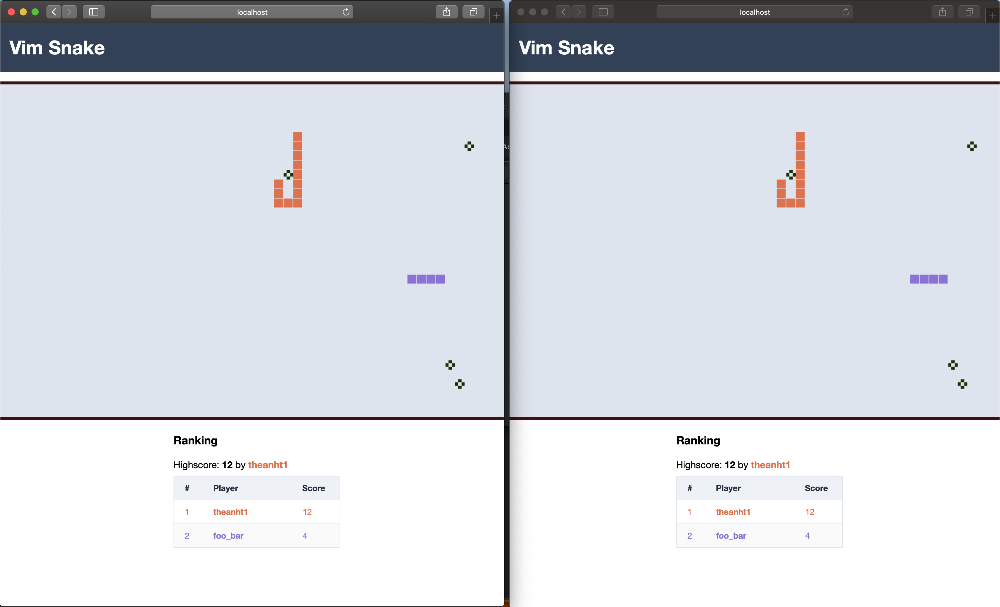

# Classical multiplayer snake game with Vim-style keybinding

This is a project using Phoenix framework and Phaser to make a multiplayer snake game, inspired by vimsnake.com

Live demo can be found on [snake.theanht1.dev](https://snake.theanht1.dev) or [Heroku](https://vim-snake.herokuapp.com)

### Preview



### Requirements

- [Elixir 1.19 or later](https://elixir-lang.org/install.html)
- Erlang 28 or later
- Node.js v22
- PostgreSQL

### Up and Running

- Install package

```
mix deps.get
cd assets && npm i && cd ..
```

- Create and migrate database

```
mix ecto.create
mix ecto.migrate
```

- Start dev server

```
mix phx.server
```

Now you can visit [`localhost:4000`](http://localhost:4000) from your browser.

### Running with Docker

The easiest way to run the application is using Docker Compose, which will set up both the Phoenix app and PostgreSQL database:

- Generate a secret key base (required for production):

```bash
mix phx.gen.secret
```

- Update `docker-compose.yml` with the generated secret key (replace `SECRET_KEY_BASE` value)

- Start the application:

```bash
# Build and start both services
docker-compose up

# Or run in detached mode (background)
docker-compose up -d
```

- View logs:

```bash
docker-compose logs -f web
```

- Stop the application:

```bash
# Stop services
docker-compose down

# Stop and remove database volumes (clean slate)
docker-compose down -v
```

The application will be available at [`localhost:4000`](http://localhost:4000).

**Note:** The Docker setup automatically runs database migrations on startup.

### Deployment

You can follow [this instruction](https://hexdocs.pm/phoenix/deployment.html) to configure for production

### TODOs

- Persist username to local storage
- Improve snake head visualization
- Re-enable login feature (with FB or Google) for reserving username and saving personal highscore
- Add unit tests
